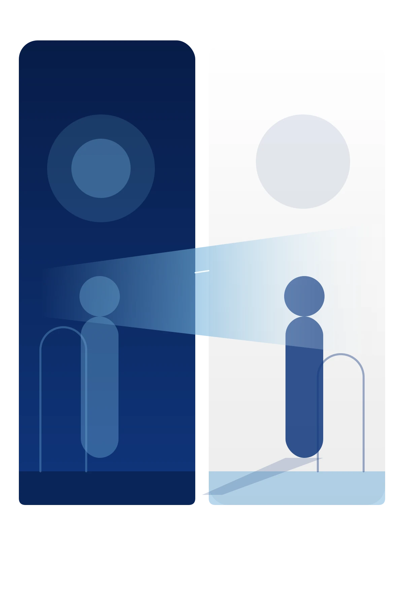

<div align="center">

# Imam Wijayanto — Personal Portfolio

**Software Development · Data Analytics · Artificial Intelligence · Visual Storytelling**

A personal portfolio showcasing selected software projects, machine learning research, and creative work — built with a modern editorial design.

[**View Live Website**](https://imam-portfolio-7qd6.vercel.app/) · [**Explore Projects**](https://imam-portfolio-7qd6.vercel.app/#portfolio) · [**Get in Touch**](mailto:imamwijayanto62@gmail.com)


</div>

---

## Overview

I'm **Imam Wijayanto**, an Informatics graduate currently pursuing a Master's degree in Informatics at Telkom University. My interests span frontend engineering, data analytics, artificial intelligence, and visual production.

This website brings together **13 projects across three disciplines**:

- **Software Development & Data Analytics** — web/mobile interfaces and data visualization.
- **AI & Machine Learning** — computer vision and financial time-series research.
- **Creative Portfolio** — film, video production, and visual storytelling.

### Featured work

<div align="center">
  <a href="https://imam-portfolio-7qd6.vercel.app/projects/badminton-pose-ai"></a>
  <a href="https://imam-portfolio-7qd6.vercel.app/projects/wave-education"></a>
  <a href="https://imam-portfolio-7qd6.vercel.app/projects/antara"></a>
</div>

## Selected Projects

Click a project name to open its case page on the live website. Repository links are included only where available.

### Software Development & Data Analytics

| Project | Focus | Source code |
| --- | --- | --- |
| [MarketWatch-ID Lite](https://imam-portfolio-7qd6.vercel.app/projects/marketwatch-id-lite) | Financial-market monitoring dashboard | — |
| [Pollusafe-App](https://imam-portfolio-7qd6.vercel.app/projects/pollusafe-app) | Air-quality monitoring mobile application; **frontend contribution** | [GitHub](https://github.com/ditorizkyka/Pollusafe-App) |
| [Wave Education](https://imam-portfolio-7qd6.vercel.app/projects/wave-education) | Interactive programming education; **frontend contribution** | [GitHub](https://github.com/ditorizkyka/Wave-Education) |
| [Money Mate](https://imam-portfolio-7qd6.vercel.app/projects/money-mate) | Personal expense tracking for mobile and web; **frontend contribution to both** | [GitHub](https://github.com/imamwijaya/Money-Mate-ABP-Projects) |
| [Citi Bike NYC Visualization](https://imam-portfolio-7qd6.vercel.app/projects/citi-bike-nyc) | Urban mobility data visualization | — |

### AI & Machine Learning

| Project | Focus |
| --- | --- |
| [Dynamic Badminton Pose Classification](https://imam-portfolio-7qd6.vercel.app/projects/badminton-pose-ai) | CNN–LSTM model using human pose landmarks for temporal movement classification |
| [Multi-Horizon XAU/USD Forecasting](https://imam-portfolio-7qd6.vercel.app/projects/xauusd-forecasting) | Master's thesis research combining Temporal Convolutional Networks and FinBERT-based financial news sentiment; **ongoing research** |

### Creative Portfolio

[Antara](https://imam-portfolio-7qd6.vercel.app/projects/antara) · [Change](https://imam-portfolio-7qd6.vercel.app/projects/change) · [Beauty and Diversity in Pati](https://imam-portfolio-7qd6.vercel.app/projects/beauty-diversity-pati) · [Reaksi](https://imam-portfolio-7qd6.vercel.app/projects/reaksi) · [Vlog Cegah Tangkal Narkoba](https://imam-portfolio-7qd6.vercel.app/projects/vlog-cegah-narkoba) · [Kanvas Merah](https://imam-portfolio-7qd6.vercel.app/projects/kanvas-merah)

> **Project attribution:** Several projects were developed collaboratively. Descriptions distinguish my frontend work from other team contributions. Research projects are described according to their current status; no unpublished final thesis results are claimed.

## Website Features

- Responsive portfolio layout with three visual card styles and category-based filtering.
- Dedicated project pages with contextual descriptions and previous/next navigation.
- About Me section featuring an original personal portrait.
- Animated SVG details and scroll reveals, with reduced-motion support.
- Accessible navigation, visible focus styles, and descriptive image alternatives.
- Per-page metadata, canonical URLs, sitemap, and social sharing metadata.
- Contact links for email, LinkedIn, GitHub, and WhatsApp.

## Tech Stack

| Area | Technologies |
| --- | --- |
| Framework | Next.js 15 (App Router), React 19 |
| Language | TypeScript |
| Styling | Tailwind CSS 3, CSS animations |
| Icons | Lucide React |
| Images | Next.js Image, WebP and SVG assets |
| Deployment | Vercel |

This portfolio is a **frontend-only website** and does not require a database or backend service.

## Getting Started

### Prerequisites

- Node.js **20.9 or newer**
- npm

### Run locally

```bash
# Clone the repository
git clone https://github.com/imamwijaya/imam-portfolio.git
cd imam-portfolio

# Install dependencies
npm install

# Start the development server
npm run dev
```

Visit **http://localhost:3000**.

### Verify before deployment

```bash
npm run qa:assets   # Verify original asset integrity and references
npm run typecheck   # Run TypeScript checks
npm run build       # Create an optimized production build
npm run start       # Serve the production build locally
```

### Environment variables (optional)

The site URL is detected automatically on Vercel. For a custom production domain, set:

```env
NEXT_PUBLIC_SITE_URL=https://your-domain.com
```

No API keys or database credentials are needed for the existing portfolio features.

## Project Structure

```text
imam-portfolio/
├── public/
│   ├── about/                 # Personal portrait
│   └── projects/              # Artwork and SVG decorations
├── src/
│   ├── app/                   # App Router pages, metadata, styles
│   │   └── projects/[slug]/   # Dynamic project pages
│   ├── components/            # Portfolio UI and shared components
│   ├── data/                  # Project, contact, and site content
│   └── types/                 # TypeScript types
├── scripts/                   # Asset verification
├── qa/                        # Original asset integrity manifest
├── package.json
└── README.md
```

## Customize Content

| File | What to update |
| --- | --- |
| `src/data/projects.ts` | Project titles, summaries, categories, roles, technologies, links, and artwork paths |
| `src/data/project-details.ts` | Supported context and contribution details for project pages |
| `src/data/content.ts` | Contact information and skill groups |
| `src/components/AboutSection.tsx` | About Me copy and portrait presentation |
| `src/app/globals.css` | Typography, colors, and animation styles |

**Design palette:** Navy `#10367D` · Light Gray `#EBEBEB` · Light Blue `#74B3DC`.

The existing project artwork, decorative SVG files, and portrait are intentionally preserved as part of the visual identity.

## Deployment

The production site is hosted on **Vercel** and connected to this repository.

To deploy your own version, import the repository into Vercel, choose the **Next.js** framework preset, and use the default install/build settings. Pushes to the configured production branch can trigger new deployments.

**Live website:** https://imam-portfolio-7qd6.vercel.app/

## Contact

- **Website:** [imam-portfolio-7qd6.vercel.app](https://imam-portfolio-7qd6.vercel.app/)
- **Email:** [imamwijayanto62@gmail.com](mailto:imamwijayanto62@gmail.com)
- **LinkedIn:** [imam-wijayanto](https://www.linkedin.com/in/imam-wijayanto/)
- **GitHub:** [@imamwijaya](https://github.com/imamwijaya)

---

<div align="center">
  <sub>Designed and developed by Imam Wijayanto.</sub>
</div>
